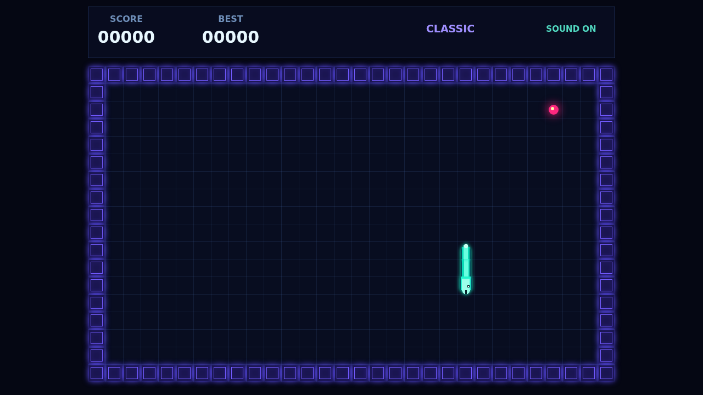

# Coil

Coil is a fast neon grid serpent built around the route you choose, not just how long you survive. The coil never stops: guide its luminous head between its own growing trail and the violet wall border, eating bright pulses one clean turn at a time.

Every pulse adds one cell. A hurried reversal is impossible, and every bend you leave behind becomes part of the maze you must navigate next.

The real chase is the combo. Reach another pulse before the timer drains to climb from x2 toward x5; hesitate too long and the multiplier snaps back to one. Efficient paths turn an ordinary round into a high-scoring run.

Play with the arrow keys or WASD, pause with P or Escape, and toggle the original synthwave soundtrack with M.
